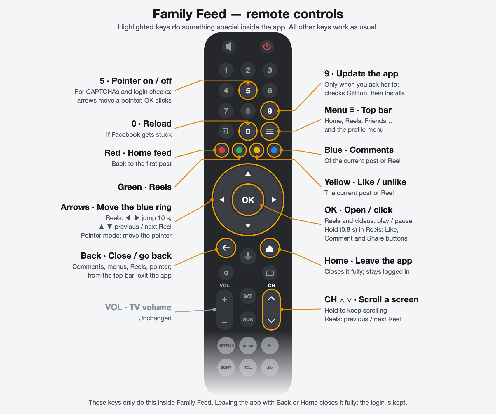

# Family Feed

An Android TV app for my mom that opens Facebook's website (www.facebook.com, desktop layout) in a full-screen WebView, so she can browse the feed and watch videos and Reels using only the TV remote.

- D-pad moves a visible focus ring between posts and buttons, and OK clicks.
- Back closes fullscreen video, then goes back in history.
- Colour keys, CH ∧ / ∨ and a few other keys are shortcuts, and a pointer appears for CAPTCHAs; see
  [Remote controls](#remote-controls).
- Login is kept across restarts and reboots.
- Builds are signed and published as GitHub Releases.

Tested on a TCL 55C6K (Google TV, Android 14). Install with `adb install -r family-feed.apk`, or download the APK from the Releases page.

Not affiliated with Facebook or Meta.

## Remote controls

All keys are handled inside the app only; no system-wide remote settings are changed.

  

The tables below give the details for each part of the app.

### Feed

| Key | Action |
|---|---|
| Up / Down | Move through the parts of a post (photo or video, "See more", Like / Comment / Share, comments when shown), then on to the next post. Above the first post: the "What's on your mind" box and Stories, then the top bar |
| Left / Right | Move along the Like / Comment / Share row (and between Stories or other cards) |
| OK | Open what is selected. On a video: play it large over the page (see Videos) |
| CH ∨ / CH ∧ | Scroll one screen down / up; hold to scroll continuously |
| Back | Jump to the top bar (Home tab); Back again on the top bar closes the app |

On the top bar, Left / Right move between tabs (Home, Reels, Friends...), Down goes back into the page and OK
opens the tab.

Each post fits on one screen: when a post's photo or video would make it taller than the screen, the photo or video
is shown smaller (down to half size); the text keeps its size.

### Reels

| Key | Action |
|---|---|
| Left / Right | Seek back / forward 10 seconds (hold for a steady repeat) |
| Up / Down, CH ∧ / CH ∨ | Previous / next Reel; it starts playing by itself |
| OK | Play / pause |
| OK held (0.8 s) | Button mode: a "Buttons: Back to return" banner, and the arrows move the focus ring between Like, Comment, Share and the other buttons; OK presses the selected one |
| Back | In button mode: back to watching the same Reel. Otherwise: back to the feed in one step, however many Reels were watched |

Button mode also ends with another long OK, or after 8 seconds without a key. Sound is always switched on. While
seeking, a "+10s" / "-10s" flash and a progress bar appear for a moment.

### Videos in the feed

| Key | Action |
|---|---|
| OK | Play / pause (the video fills the screen below the top bar) |
| Left / Right | Seek back / forward 10 seconds |
| Back | Return to the feed (the video pauses) |

### Comments, menus and other pages

The arrows move the focus ring to the nearest button or link in that direction, and OK opens it. Opening a post's
comments (Blue, or OK on Comment) scrolls to the first comment. CH ∨ / CH ∧ scroll the comments (hold for
continuous scrolling). Back leaves a text box first, then closes the comments or menu.

### Login pages and CAPTCHAs (pointer mode)

On Facebook's login and security-check pages, and whenever a CAPTCHA ("I'm not a robot", image puzzles) is on
screen, a pointer appears with a "Pointer mode" note in the top-right corner. CAPTCHAs run in a separate frame the
focus ring can't reach, so a pointer is used instead.

| Key | Action |
|---|---|
| Arrows | Move the pointer (hold to move faster); at the top or bottom edge, scroll |
| OK | Click where the pointer is (on a text box: opens the TV keyboard) |
| Back | Pointer off; it stays off on that page |
| 5 | Pointer on or off, on any page |

While a CAPTCHA is shown the page is zoomed out a little, so the whole puzzle and its Verify button fit on screen.
The pointer turns itself off when Facebook moves on. Every choice is made with the remote; nothing is solved
automatically.

### Shortcut keys

| Key | Action |
|---|---|
| Red | Home feed (from the feed itself: back to the first post) |
| Green | Reels |
| Yellow | Like / unlike the current post or Reel |
| Blue | Open the comments of the current post or Reel |
| Menu (≡) | Jump to the top bar |
| 0 | Reload the page, if Facebook gets stuck |
| 5 | Pointer mode on / off (see above) |
| 9 | Check for an update and install it (see [Updating the app](#updating-the-app-key-9)) |
| Play/Pause, Rewind, Fast-forward | Control the current video, on remotes that have these keys |

Leaving the app, with Back from the top bar or with the Home button, closes it completely and frees its memory;
the login is kept.

## Debug vs release builds

- `./gradlew assembleDebug` builds `com.avinash.facebookfeed.debug`, labelled "Family Feed (debug)", signed with
  the local debug key. It installs next to the release app, with its own login. It can open any https page, for
  testing pages Facebook shows only sometimes:
  `adb shell am start -n com.avinash.facebookfeed.debug/com.avinash.facebookfeed.MainActivity --es url https://www.google.com/recaptcha/api2/demo`
  (release builds ignore the `url` extra). For testing key 9, `--es update_api http://127.0.0.1:8000/latest.json`
  makes it read a release in GitHub's JSON format from a local server (reached with `adb reverse tcp:8000 tcp:8000`)
  instead of GitHub.
- `./gradlew assembleRelease` builds `com.avinash.facebookfeed`. It is signed only when `KEYSTORE_PATH`,
  `KEYSTORE_PASSWORD`, `KEY_ALIAS` and `KEY_PASSWORD` are set in the environment; otherwise the APK is unsigned.
  No keystore or password is ever stored in the repository.
- The version comes from `-PversionName=1.2.3 -PversionCode=10203` (defaults `0.0.0-dev` and `1`).

## Releasing

Releases are built and signed only by GitHub Actions (`.github/workflows/release.yml`), using the `release`
environment's secrets `ANDROID_SIGNING_KEY_BASE64`, `ANDROID_KEYSTORE_PASSWORD`, `ANDROID_KEY_ALIAS`,
`ANDROID_KEY_PASSWORD` and the variable `ANDROID_SIGNING_CERT_SHA256`.

- **Release:** push a tag like `v1.0.0` on a commit that is on `main`. CI builds and signs the APK, checks its
  certificate fingerprint and package, and publishes a GitHub Release with `family-feed.apk` and
  `family-feed.apk.sha256`. The version code is `MAJOR*10000 + MINOR*100 + PATCH`.
- **Dry run:** `gh workflow run release.yml --ref main`. It builds and signs exactly like a release and uploads the
  APK as a workflow artifact (kept for 1 day), but creates no tag and no release.

`scripts/check-cert.sh <apk> <sha256>` is the fingerprint check the workflow uses; it also works locally.

## Updating the app (key 9)

The app never updates by itself. Pressing **9** checks this repository's latest GitHub Release (drafts and
prereleases never count) and, if it is newer, downloads `family-feed.apk`, checks it against
`family-feed.apk.sha256`, checks that it is this app, newer, and signed with the same certificate as the installed
app, and installs it. A banner shows each step in Hindi and English; anything that fails is shown and nothing is
installed.

- **Once:** Android asks to allow "Install unknown apps" for Family Feed. Pressing 9 opens that settings page; press
  OK on Family Feed, then Back.
- **First update after installing with adb:** Android shows "Do you want to update this app?". The focus starts on
  Cancel: press Left onto **Update**, then OK.
- **Later updates** install without that screen (the app is then its own installer).
- The app closes to be replaced; open Family Feed again from the home screen. The login is kept.

The first release with key 9 still has to be installed by hand (download from GitHub, check, `adb install -r`).

## Repository layout

- `app/src/main/assets/inject.js`: the remote-control navigation injected into the page.
- `tools/icon/Icon.java`: generates the launcher icon and TV banner
  (`java -Djava.awt.headless=true tools/icon/Icon.java app/src/main/res <preview dir>`).
- `tools/remote/make.py`: draws `docs/remote-controls.png` (see the comment at its top for the render command).
